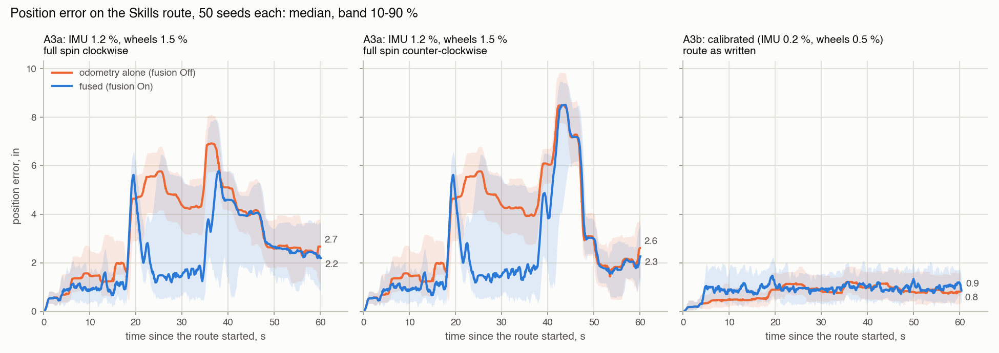
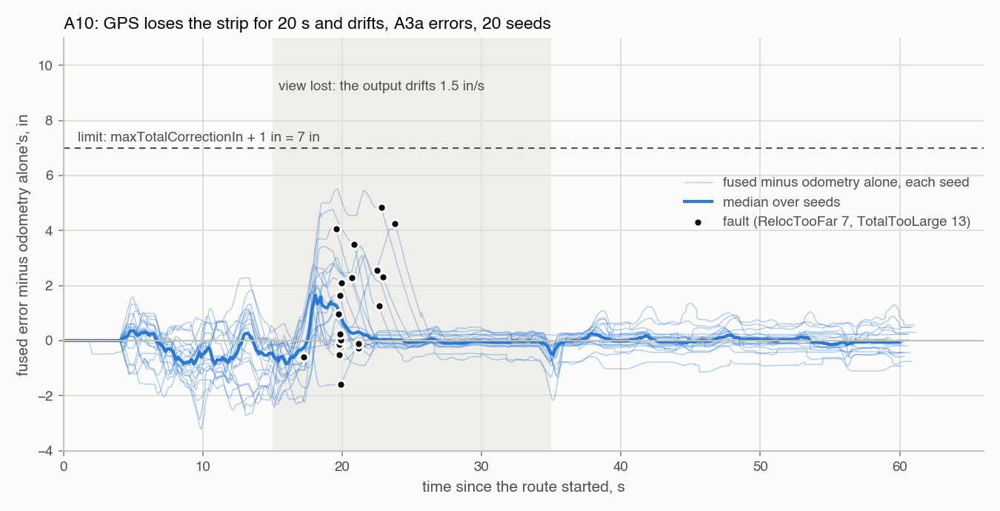
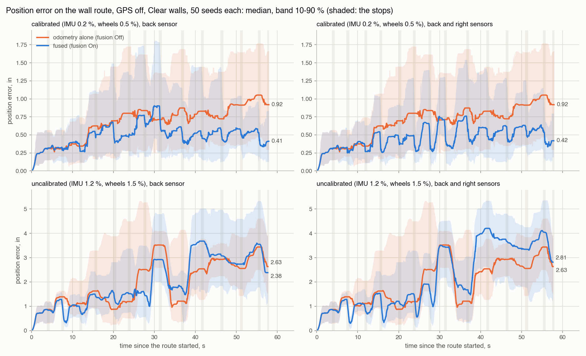

# Overnight report: GPS fusion and wall sensors (22 Nov 2026)

Everything here ran in the simulator or was only compiled. Nothing ran on the
robot, nothing was uploaded, nothing is committed or pushed. Both filters are
Off by default, and with them Off the pose is bit-for-bit what it was before.

## Short answer

1. **Calibrate odometry first.** In the simulator a calibrated robot ends a
   60 s route about 0.9 in off; an uncalibrated one about 2.6 in off. That is
   a bigger gain than either filter gives, and both filters need it anyway.
   About half an hour on the robot (list at the end).
2. **GPS: do not switch it on at nationals. Log only (Shadow) if you want the
   data.** A healthy GPS adds nothing measurable on a calibrated robot whose
   tracking wheels slip little (heavier slip changes this: see the slip
   section). A GPS
   that loses its view and drifts slowly is followed, and no check on position
   readings can tell.
3. **Wall sensors: not ready, and not for nationals.** The first simulator
   number looked good (0.41 in against 0.92). The review took it apart: the
   real gain is about a quarter, and a 1 to 2 in set-up error or a game object
   against the wall makes the robot 2 to 3 times worse than with no sensor.

So the overnight work mostly says what not to do, which is worth knowing
before nationals. The filters are built, tested and switched off.

## What was built

| Piece | Where | State |
|---|---|---|
| GPS filter (moves x and y only, never the heading) | `src/lemlib/chassis/gpsFusion.cpp` | three builds, reviewed after the first and second |
| Wall fixes in the same filter | same file | built and reviewed; eight open design problems |
| Inertial sensor scale (`setImuScale`) | `src/lemlib/chassis/odom.cpp` | built; 1.0 until measured |
| Switches | `include/robot-config.hpp` | `GPS_FUSION_MODE = Off`, `GPS_MOUNT_MEASURED = false`, `ODOMETRY_CALIBRATED = false` |
| Simulator models, routes, two test suites | `tools/sim/` | `gps_suite.py`, `wall_suite.py`, 1054 unit checks |
| Designs with every decision and why | `docs/GPS_FUSION_DESIGN.md`, `docs/WALL_FIX_DESIGN.md` | up to date |

Movement code (`moveToPoint`, `moveToPose`, turns, PID) was not touched.
The robot build compiles. The small upload is still 32.7 KB.

Final state of the tests: GPS suite 25 pass, 0 fail, 61 reported rows. Wall
suite 66 pass, 1 fail (a second sensor adds nothing on the test route), 83
reported rows. The reported rows are where the bad news in this report lives:
they have no pass mark because nothing could make them pass.

## GPS: what the simulator says

Route: 60 s, 895 in driven, 25 stops. GPS noise 1.5 in. 50 runs per case.
In the graph, the two left panels are an uncalibrated robot: the filter helps
until its 6 in limit trips mid-route, then it hands back to odometry (the blue
line rejoins the orange). The right panel is a calibrated robot.

| Case (third build) | Odometry alone | With the filter |
|---|---|---|
| Calibrated robot, end of route | 0.82 in | 0.70 in |
| Calibrated robot, at stops | | more than 1 in worse at 6.1% of stops, more than 1 in better at 6.2% |
| Perfect odometry | 0.00 in | 0.82 in |
| Uncalibrated robot | 2.67 in | 2.22 in; faults in 43 of 50 runs and falls back to odometry |

- **Healthy GPS, calibrated robot: a wash.** No faults in 150 runs, and no
  gain you could measure.
- **Wrong set-ups are caught.** Wrong start pose, mirrored field, camera
  facing the other way: every run faults before anything is fed in. One
  exception: starting exactly on a mirror line of the field lets about 3.5 in
  through for about 12 s before the fault.
- **A blind GPS drifting fast** (0.2 in/s or more) reaches about 6 in, then
  the filter faults and the pose is back to plain odometry within 3 s.
- **A blind GPS drifting slowly** (0.1 in/s) faults in only 4 of 20 runs. The
  pose ends up to 5.4 in worse than odometry alone (median 2.6 in).
- **Shoves:** 4 in or less is recovered. 8 in or more faults.

## GPS: what changed between builds

- **Build 1** failed four of its own nine tests. A blind GPS dragged the pose
  24 to 44 in with no fault.
- **Build 2** added hard limits and an automatic return to plain odometry
  after any fault. 25 of 26 tests passed.
- **Three reviews of build 2** found no coding error (a second model written
  from the design alone agreed over 4 million ticks) but found:
  - the slow-drift problem above, which is a limit of the idea, not a bug;
  - printing from the odometry task could freeze odometry if the field
    controller ends autonomous in the middle of a print;
  - `setPose` in the middle of a routine left the filter's bookkeeping wrong;
  - the safety switches could be bypassed by calling the library directly.
- **Build 3** fixed the last three, and halved the limits (total correction
  6 in, was 12) because a filter that is only for a calibrated robot should
  give up early.

## Wall sensors: what the simulator says

Route: 58 s with 13 stops where a back-facing sensor is square to a wall.

| Case | Odometry alone | With wall fixes |
|---|---|---|
| Calibrated, one back sensor, end of route | 0.92 in | 0.41 in |
| Same, averaged over the whole route (RMS) | 0.75 in | 0.55 in |
| Calibrated, back and right sensors, end | 0.92 in | 0.42 in |
| Uncalibrated, one back sensor, end | 2.63 in | 2.38 in |
| Perfect odometry | 0.00 in | 0.26 in |

What works:
- An object 3 in or more in front of the wall: no fix taken.
- A clear wall the beam passes through to something far behind: no fix taken,
  and the sensor switches itself off.
- A GPS that faults at the start leaves the walls working.

What the review found gets through every check, on a calibrated robot, with
no fault raised:

| Situation | End error (odometry alone: 0.92 in) |
|---|---|
| Object resting 2 in in front of the wall at the stops | 2.40 in |
| Field 1 in smaller than the filter was told | 1.81 in |
| Sensor mount told 1 in too far forward | 1.81 in |
| Clear panel with something steady 2 in behind it | 2.26 in |
| GPS on as well, biased 2 in | 2.23 in (walls alone: 0.48 in) |

- The 0.41 in figure is the error 2 s after the last fix. Moving the route's
  last point changes it to anywhere from 45% to 88% of odometry alone.
- The simulated sensor's noise, beam and behaviour on clear walls are guesses
  from other teams' reports.

## Added in the morning: tracking-wheel slip

The suites above use one slip level: each tracking wheel slips about once per
33 in it rolls and loses up to 0.3 in each time (about 0.45% of its travel).
That is mild. `tools/sim/slip_sweep.py` runs a calibrated robot at heavier
slip, 30 seeds per row, median end error. One run, not reviewed.

| Slip (share of travel lost) | GPS route: odometry alone | GPS On | Wall route: odometry alone | One wall sensor |
|---|---|---|---|---|
| none | 0.61 in | 0.67 in | 0.37 in | 0.40 in |
| 0.45% (what the suites use) | 0.89 in | 0.70 in | 0.92 in | 0.41 in |
| 1.5% | 1.61 in | 0.79 in | 1.33 in | 1.31 in |
| 5% | 5.56 in | 5.68 in (faults in 27 of 30) | 5.41 in | 5.51 in |
| 10% | 8.84 in | 8.57 in (faults in 30 of 30) | 11.05 in | 11.73 in |

- **"GPS is a wash" only holds for small slip.** Around 1.5% the GPS filter
  halves the end error. From 5% it hits its 6 in limit, faults and hands back
  to odometry.
- **The wall sensor does not keep up with heavier slip.** At 1.5% it still
  takes its fixes (11 in the run looked at, the largest 1.48 in against the
  1.5 in cap) but ends no better.
- **Calibration cannot fix slip.** Slip is random, so it shows up as scatter
  between identical runs; a scale or offset error repeats.
- The model's slip is spread evenly along the route and always reads short.
  Real slip comes in bursts (hard braking, contact, a wheel lifting over a
  bump). Only the shove test covers a burst: 4 in is recovered, 8 in faults.

## What it would take on the robot

In this order. Each step is useful on its own.

0. **Find out how much the tracking wheels slip** (ten minutes, no new code):
   run the same routine five times from the same taped start and mark where
   the robot stops. Marks within about 0.5 in of each other but off target:
   a repeatable error, which calibration fixes. Marks scattered by more than
   an inch: slip, which needs more down force on the tracking wheels or an
   absolute sensor.

1. **Odometry calibration** (no new code needed):
   - ten full turns each way against a floor mark, for the inertial sensor's
     scale (`IMU_SCALE_CLOCKWISE`, `IMU_SCALE_COUNTER_CLOCKWISE`);
   - a 48 in push along a tape for each tracking wheel's true size;
   - the horizontal wheel's offset sign, still open from last session.
2. **GPS in Shadow**, only if you want the data: about ten runs of a taped
   route on a field with strips. Then cover the camera for 10 to 30 s and see
   whether the sensor's own error number rises. That one test decides whether
   switching it on is ever safe.
3. **Wall sensor**, after nationals: one sensor on the bench against the
   venue's kind of wall, before any more design work.

## Things to know

- **The next upload re-sends the 3.7 MB library package**, so do it over the
  cable. Uploads after that are small again.
- **One thing runs even with the filters Off:** a small logging task that
  wakes twice a second and does nothing. It has never run on the robot. If the
  robot misbehaves after the next upload, that is the first suspect.
- **Found in passing, in PROS itself, not fixed:** if the field controller
  ends autonomous in the middle of a `printf`, every later `printf` can hang.
  Keep prints out of autonomous routines.
- GPS strips are only guaranteed on Skills fields.
- All of this is uncommitted on `claude/serene-curie-yvp8mp`.
- Still open from before: curve sway (turn kI), horizontal wheel sign.
